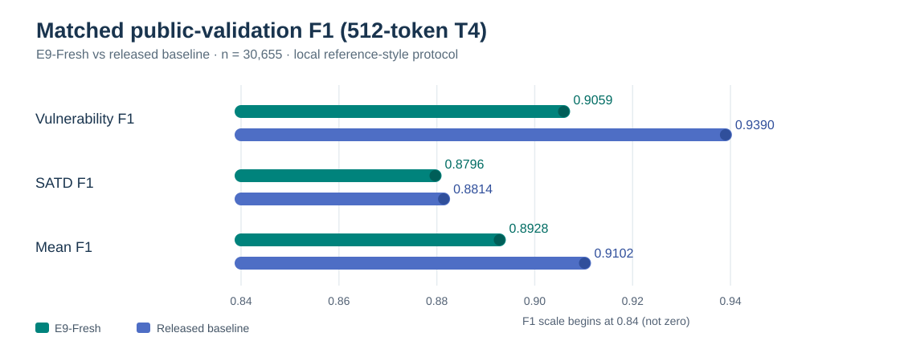

# Imbalance-Aware CodeBERT for Joint Vulnerability and SATD Classification

**NLBSE 2027 · Tool Competition · Code Comment Classification**

Independent research submission by **Md Naim Babu**, Department of Computer Science and Engineering, Pundra University of Science & Technology, Bogura, Bangladesh.

One shared [CodeBERT](https://huggingface.co/microsoft/codebert-base) encoder predicts two binary labels from the official dataset's `Function` field:

1. **Vulnerability / weakness** (label index 0)
2. **Self-admitted technical debt (SATD / MAT)** (label index 1)

**Model:** [naimNB/nlbse2027-e9-codebert](https://huggingface.co/naimNB/nlbse2027-e9-codebert) · **Training notebook:** [E9-Fresh](notebooks/E9_fresh_15k_codebert.ipynb) · **Reference-style evaluation:** [Colab T4 notebook](notebooks/E9_Colab_T4_reference_style_evaluation.ipynb) · **Official challenge:** [NLBSE 2027](https://nlbse2027.github.io/tools/)

> **Scope:** The reported results are measured on the 30,655-example **labeled public-validation split** (named `test` on Hugging Face). They are **not** organizer-hidden-test results, an official leaderboard rank, or evidence of better-than-baseline performance.

## Main result: matched 512-token evaluation

Both the selected E9 checkpoint and the released organizer baseline were tested with the same local reference-style procedure: **Tesla T4, 512-token global padding, batch 600, FP16 autocast, 10 forward-pass repetitions, sigmoid thresholds 0.5**.

| Public-validation measurement | E9-Fresh (ours) | Released baseline |
|:--|--:|--:|
| Vulnerability precision | 0.9309 | **0.9427** |
| Vulnerability recall | 0.8822 | **0.9353** |
| **Vulnerability F1** | **0.9059** | **0.9390** |
| SATD precision | **0.9829** | 0.9783 |
| SATD recall | 0.7960 | **0.8020** |
| **SATD F1** | **0.8796** | **0.8814** |
| **Mean F1** | **0.8928** | **0.9102** |
| Mean synchronized inference time | 240.09 s | 196.81 s |
| Profiler-counted GFLOPs | 2,666,509.71 | 2,666,509.71 |
| Local reference-formula score | 0.7099 | 0.7290 |

E9 achieves SATD F1 within **0.0017** of the released baseline, but the baseline leads on vulnerability F1 and overall Mean F1. The measured runtime/combined score comes from **separate Colab sessions**, with explicit CUDA synchronization added relative to the organizer's reference notebook; it is a **local estimate**, not an official efficiency ranking.

Source-of-truth JSON: [E9 results](results/e9/colab_t4_reference_style_512_metrics.json) · [matched baseline results](results/baseline/colab_t4_matched_512_metrics.json) · [protocol details](docs/OFFICIAL_EVALUATION.md).



## Quick start: run the model

Use Python 3.10+ with a compatible PyTorch installation (CPU works for a single example; a CUDA GPU is recommended for the full dataset).

```bash
git clone https://github.com/naimNB/nlbse2027-multitask-code-classification.git
cd nlbse2027-multitask-code-classification

# Use a virtual environment; install a suitable PyTorch build for your system.
python -m pip install -r requirements.txt

# Download the published 2-label checkpoint automatically and predict.
python scripts/predict.py --code 'int f(int x) { // FIXME: handle edge cases
 return x; }'
```

Expected output: a JSON record containing `probabilities` and `predictions` for both tasks. **This is a functional inference example**, not a calibrated security assessment.

For a local file or batch of functions:

```bash
python scripts/predict.py --file path/to/function.c
python scripts/predict.py --jsonl path/to/functions.jsonl --batch-size 8
```

Each JSONL line can contain `{"Function": "source code"}`; plain JSON strings are also accepted. The CLI uses **max length 512** and a fixed **0.5** threshold by default; it uses dynamic per-batch padding, so it is **not** the exact full-dataset organizer performance/timing benchmark. See `--help` for options.

## Reproduce the evaluations

**Reference-style 512-token validation and resource measurements:** open the already-run Colab notebooks and run them with a **Tesla T4 GPU**:

- [E9-Fresh reference-style evaluation](https://colab.research.google.com/github/naimNB/nlbse2027-multitask-code-classification/blob/main/notebooks/E9_Colab_T4_reference_style_evaluation.ipynb)
- [Matched released-baseline evaluation](https://colab.research.google.com/github/naimNB/nlbse2027-multitask-code-classification/blob/main/notebooks/BASELINE_Colab_T4_matched_512_evaluation.ipynb)

Both notebooks produce independently recorded JSON metrics. The computation uses global padding and FP16. The evaluator's `torch.profiler` reports **billions of operations**; this is not FLOPs-per-second throughput.

**Historical 256-token comparison:** the original evaluation script reproduces the previously verified E9 **Mean F1 0.7830049** when used with 256-token truncation and default batch-wise padding:

```bash
python scripts/evaluate_public.py \
  --model-dir naimNB/nlbse2027-e9-codebert \
  --max-length 256 --batch-size 16 --threshold 0.5 \
  --output results_256_local.json
```

The historical 256-token baseline and E3/E5/E8 comparisons are documented in [results/EXPERIMENTS.md](results/EXPERIMENTS.md). **Do not compare their F1 values directly to the 512-token table.**

**Data:** [NLBSE/nlbse27-code-comment-classification](https://huggingface.co/datasets/NLBSE/nlbse27-code-comment-classification) (`train`: 214,586; public labeled `test`: 30,655). Organizers retain a separate 61,311-sample hidden test.

## Model and training

- **Architecture:** `microsoft/codebert-base` shared encoder, two independent classification logits, sigmoid output.
- **E9-Fresh:** independent run from pretrained CodeBERT; **15,000** optimization steps (not an E8 continuation).
- **Batch size / length:** 8 / 256 during fine-tuning; AdamW, learning rate `2e-5`, weight decay `0.01`.
- **Class imbalance:** weighted BCE-with-logits with positive-class weights `[1.0, 10.0]` in vulnerability/SATD order.
- **Schedule:** 1,500 warmup steps and linear decay; internal pilot F1 assessed every 1,000 steps.
- **Checkpoint:** selected on the **5,000-example internal pilot** at step **13,000**; final E9 pilot Mean F1 `0.75585`.
- **Training code:** [standalone Kaggle notebook](notebooks/E9_fresh_15k_codebert.ipynb) and [captured run configuration](results/e9/run_config.json).

A clean internal holdout of 16,420 rows had Mean F1 `0.77650` under the historical 256-token protocol. This is **within-project validation**, not evidence of unseen-project generalization.

## Repository guide

| Location | Purpose |
|:--|:--|
| [`scripts/predict.py`](scripts/predict.py) | CLI inference from code, files or JSONL |
| [`scripts/evaluate_public.py`](scripts/evaluate_public.py) | 256-token-style public evaluation |
| [`notebooks/`](notebooks/) | Source training notebook and matched Colab evaluation notebooks |
| [`results/e9/`](results/e9/) | E9 pilot/holdout and public-validation metrics |
| [`results/baseline/`](results/baseline/) | Matched released-baseline metrics |
| [`figures/`](figures/) | Training dynamics and protocol-labeled visualizations |
| [`docs/OFFICIAL_EVALUATION.md`](docs/OFFICIAL_EVALUATION.md) | T4 protocol, score calculation and caveats |
| [`docs/REPRODUCIBILITY.md`](docs/REPRODUCIBILITY.md) | Training and audit limitations |
| [`docs/SUBMISSION_CHECKLIST.md`](docs/SUBMISSION_CHECKLIST.md) | Competition submission checklist |

To check the stored result artifacts **without downloading a 499 MB model**:

```bash
python -m unittest discover -s tests -v
```

## Limitations

- This is a **single-seed participant experiment**, not a controlled multiple-seed ablation or a novel model architecture.
- The internal pilot/holdout partitions share projects and many file identities with training. Full training rerun on a pinned upstream dataset revision has **not** been independently verified.
- The labeled public-validation data has been consulted during development; it is not a blind held-out test.
- The published model is an experimental classifier; **do not rely on it as a security audit**.
- Organizer hidden-test F1, execution cost and final ranking are unknown. The local combined score uses a timer methodology that differs from the original reference.

## Citation and attribution

This entry uses [the official NLBSE 2027 competition dataset and rules](https://github.com/nlbse2027/code-comment-classification), [MADE-WIC](https://doi.org/10.1145/3691620.3695348), and [CodeBERT](https://aclanthology.org/2020.findings-emnlp.139/). Refer to the official competition site for the organizers' complete required references.

**Researcher:** Md Naim Babu · Pundra University of Science & Technology, Department of CSE, Bangladesh.  
**Contact:** naim.cse2004@gmail.com

This is an **independent participant repository**, not an organizer-maintained or accepted publication. The competition paper is submitted separately through the official form.
