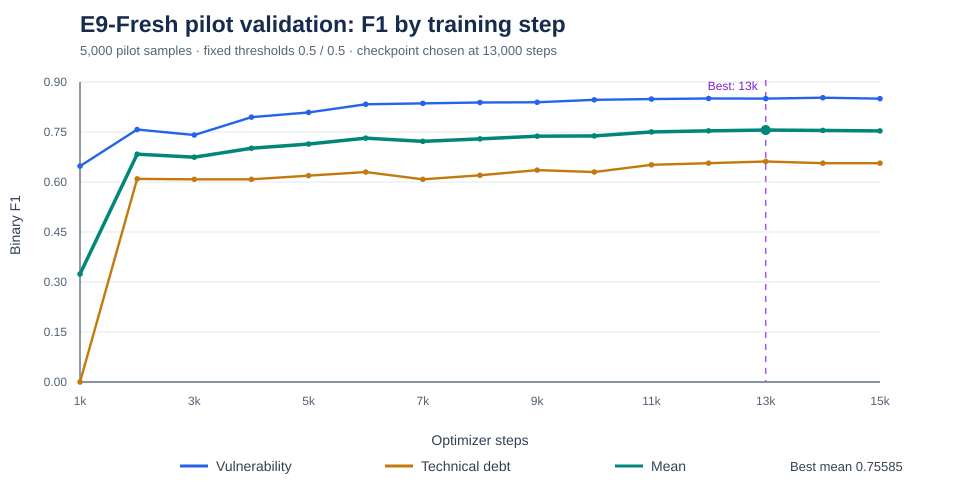
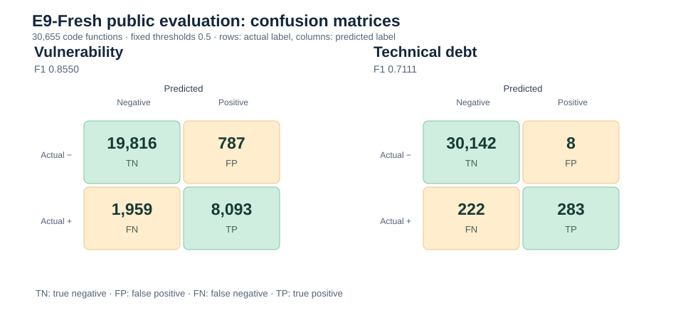

# NLBSE 2027 — Multitask Code Classification

Reproducible experiments investigating CodeBERT fine-tuning for **code weakness/vulnerability** and **self-admitted technical debt (MAT/SATD)** classification, prepared for the NLBSE 2027 Tool Competition.

**Status:** Research in progress. E9-Fresh has completed 15,000 training steps and public-split evaluation; the paper is a working draft, **not an accepted publication**.

**Researcher:** Md Naim Babu · [GitHub](https://github.com/naimNB)

## Approach

- Shared encoder: `microsoft/codebert-base`, with two binary output logits.
- E3/E5: `BCEWithLogitsLoss(pos_weight=[1.0, 10.0])` to investigate rare technical-debt positives.
- Tokenizer truncation: 256 tokens in the standardized local public-split evaluations.
- E5: up to 6,000 optimization steps; checkpoint selected by pilot validation mean F1 at step 4,000.
- E7: 6,000-step weighted BCE with linear scheduling (pilot evaluated).
- E8: 10,000-step weighted BCE with 1,000-step warmup and linear scheduling, best checkpoint at step 10,000; pilot mean F1 0.7270.
- **E9-Fresh**: new CodeBERT initialization, 15,000-step weighted BCE with 1,500 warmup steps and linear decay; best checkpoint at step 13,000, pilot mean F1 0.7559.

## Results — public evaluation split (30,655 samples)

All rows below were evaluated locally at **fixed thresholds (0.5, 0.5)** with 256-token truncation. These are **not hidden-test or leaderboard scores**.

| Checkpoint | Weakness F1 | Debt F1 | Mean F1 |
|---|---:|---:|---:|
| Released NLBSE CodeBERT baseline | **0.8760** | **0.7143** | **0.7952** |
| E3 — Weighted BCE, 2,000 steps | 0.7834 | 0.6872 | 0.7353 |
| E5 — Weighted BCE, best step 4,000 | 0.8192 | 0.6933 | 0.7563 |
| E8 — Weighted BCE + scheduler, 10,000 steps | 0.8504 | 0.6995 | 0.7750 |
| **E9-Fresh — Weighted BCE + scheduler, best step 13,000** | **0.8550** | **0.7111** | **0.7830** |

The released checkpoint still outperforms E9 by about **0.0122 mean-F1 points** on this **local** comparison. The organizers report a different baseline mean F1 (~0.910) in their task README; the discrepancy is unresolved, so our local baseline figure must not be mistaken for the official published baseline result. We do not claim a state-of-the-art result.

See [results/EXPERIMENTS.md](results/EXPERIMENTS.md) for precision/recall, split-specific diagnostics, and limitations.

## Reproduce the evaluation

Source dataset: [NLBSE/nlbse27-code-comment-classification](https://huggingface.co/datasets/NLBSE/nlbse27-code-comment-classification).

Install the Python packages in [requirements.txt](requirements.txt), using a compatible CUDA-enabled PyTorch installation on Kaggle rather than replacing Kaggle's installed PyTorch with a CPU-only wheel.

To evaluate a saved local checkpoint:

```bash
python scripts/evaluate_public.py --model-dir /path/to/checkpoint --max-length 256
```

This command evaluates with fixed thresholds of 0.5. Do not tune on the public evaluation split. The script does not compute competition GFLOPs, official ranking, or hidden-test performance.

## Repository layout

- `scripts/evaluate_public.py` — evaluation of either a local checkpoint or a public Hugging Face model.
- `results/EXPERIMENTS.md` — recorded E0–E9 experiment results.
- [`notebooks/E9_fresh_15k_codebert.ipynb`](notebooks/E9_fresh_15k_codebert.ipynb) — audited, output-free standalone training notebook.
- [`results/e9/`](results/e9/) — E9 run configuration and pilot, holdout, and public evaluation JSON files.
- [`figures/`](figures/) — E9 SVG pilot-F1 and public-test confusion-matrix figures.
- `docs/REPRODUCIBILITY.md` — split construction, checkpoints, limitations, pending audits.
- `paper/draft.md` — preliminary empirical-study write-up.
- `notebooks/` — cleaned, output-free E9 notebook (code preserved; outputs intentionally removed).

## Important limitations

1. Pilot/holdout evaluation shares source projects and frequently source-file identities with training; it is **not project-disjoint**.
2. Pilot-to-holdout exact-code overlap was observed and filtered for the E3 clean diagnostic.
3. Training budgets, shuffling, and seeds were not fully controlled across all historical runs.
4. The public split was consulted during research, so it should not be called an untouched independent test.
5. Model weights (~500 MB each), training datasets, raw predictions and split pickle files are not included in Git. E9 best weights were uploaded to Hugging Face; basic unauthenticated CUDA loading has passed; unauthenticated public-split evaluation now exactly reproduces archived E9 metrics.

## References and attribution

- [Official NLBSE 2027 task repository](https://github.com/nlbse2027/code-comment-classification)
- [Official released CodeBERT checkpoint](https://huggingface.co/NLBSE/nlbse27-code-comment-classification-baseline)
- [CodeBERT paper](https://arxiv.org/abs/2002.08155)

This is an independent participant project; it is not an official NLBSE organizer repository.

## E9 reproducibility record

The [E9 standalone notebook](notebooks/E9_fresh_15k_codebert.ipynb) and actual recorded [run configuration](results/e9/run_config.json), [pilot metrics](results/e9/best_metrics.json), [internal holdout metrics](results/e9/clean_holdout_metrics.json), and [public evaluation](results/e9/public_test_metrics.json) are now in the repository. The source notebook was checked for Python syntax, and its execution outputs and ad-hoc duplicate download cells were removed for publication. **This does not mean the complete training run was re-executed independently.** The uploaded E9 metadata ZIP has all 15 validation records and confirms best pilot checkpoint at step 13,000. The public evaluation JSON is transcribed from the participant's separate recorded public-evaluation output; it was not inside the uploaded metadata ZIP.





The participant's E9 best-checkpoint model files were **uploaded to Hugging Face**: [naimNB/nlbse2027-e9-codebert](https://huggingface.co/naimNB/nlbse2027-e9-codebert), commit [`33031d7072989699bd27a25284b60d81b396b26b`](https://huggingface.co/naimNB/nlbse2027-e9-codebert/commit/33031d7072989699bd27a25284b60d81b396b26b). This upload is verified by the participant's successful CLI commit log; independent download/loading and public visibility are **verified** by loading this model on a fresh Kaggle GPU session without a Hugging Face token. The participant also retains a verified local `E9_BEST_MODEL.zip` backup. Hosted model public-test replication now matches exactly (vulnerability F1 0.8549545743, SATD F1 0.7110552764, mean 0.7830049253). A competition-compatible inference wrapper still requires verification before final submission.

## Hosted E9 checkpoint replication (22 November 2026)

The participant independently evaluated the public Hugging Face model [`naimNB/nlbse2027-e9-codebert`](https://huggingface.co/naimNB/nlbse2027-e9-codebert) using `scripts/evaluate_public.py` in a new Kaggle GPU notebook **without a Hugging Face access token**. The hosted checkpoint downloaded successfully and produced **bit-for-bit identical reported task metrics and confusion matrices** to the prior local-checkpoint public evaluation on 30,655 examples at max length 256 and thresholds `[0.5, 0.5]`:

| Task | Precision | Recall | F1 | Confusion matrix |
|---|---:|---:|---:|---|
| Vulnerability | 0.9113738739 | 0.8051134103 | 0.8549545743 | `[[19816,787],[1959,8093]]` |
| SATD | 0.9725085911 | 0.5603960396 | 0.7110552764 | `[[30142,8],[222,283]]` |
| **Mean** | — | — | **0.7830049253** | — |

Original local-checkpoint inference wall time: **441.8847 s**. Hosted-checkpoint inference wall time: **457.1878 s**. These are different sessions and do not establish a controlled speed comparison or official compute ranking. This confirms checkpoint portability and **evaluation replication**, not full training reproducibility, blind generalization or organizer hidden-test performance.

The competition organizer's README also reports a **different baseline evaluation score** (mean F1 approximately 0.910); our earlier locally evaluated baseline checkpoint gave 0.7952. The protocols/processing underlying that discrepancy have not been reconciled, so do not present the locally evaluated baseline score as the organizers' official score.

## Hugging Face model card publication

The participant also uploaded the public model card `README.md` to the [E9 Hugging Face model repository](https://huggingface.co/naimNB/nlbse2027-e9-codebert), confirmed by commit [`6331998768f9112f440ca029429640281f4df1b8`](https://huggingface.co/naimNB/nlbse2027-e9-codebert/commit/6331998768f9112f440ca029429640281f4df1b8). The model card documents architecture, training, independent 30,655-row public-test replication, limitations, and usage. Publication is confirmed from the participant's upload log; organizer-compatible inference and official efficiency scoring are still pending.
